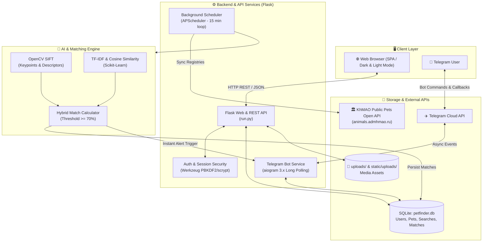
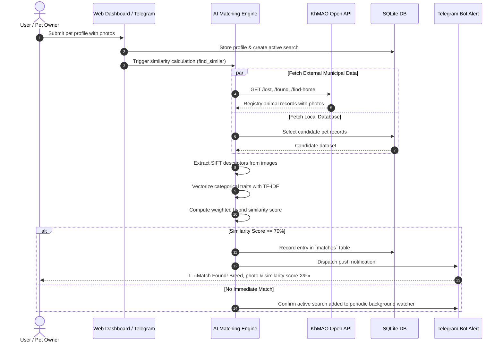

<div align="center">

# 🐾 PetFinder (docXaOs)
### AI & Open-Data Powered Lost & Found Pet Matcher
### Интеллектуальный сервис поиска и идентификации животных

[](https://python.org)
[](https://flask.palletsprojects.com/)
[](https://opencv.org/)
[](https://docs.aiogram.dev/)
[](https://scikit-learn.org/)

**[🇬🇧 English Version](#-english)** • **[🇷🇺 Русская версия](#-русский)**

</div>

---

<a name="-english"></a>
## 🇬🇧 English

### 📌 Overview
**PetFinder (docXaOs)** is an end-to-end, cross-platform intelligent system engineered to automate the search, identification, and matching of lost, found, and shelter pets. Originally conceptualized and built for open-data innovation, the platform integrates official government municipal registries (KhMAO Public Animal API), computer vision (OpenCV SIFT descriptors & color histograms), NLP-based textual attribute similarity (TF-IDF & cosine similarity via scikit-learn), an interactive glassmorphic web dashboard with dark/light themes, and an asynchronous Telegram bot for real-time notifications.

---

### ✨ Key Features

- 🔄 **Government Registry Ingestion**: Automatic real-time querying & ingestion from the official KhMAO Pets Open API (`/lost`, `/found`, `/find-home`).
- 👁️ **Computer Vision (SIFT)**: Scale-Invariant Feature Transform (SIFT) keypoint extraction and color histogram clustering to match pet images regardless of rotation, lighting, and camera angle.
- 🧠 **Hybrid Matching Engine**: Blends visual descriptors with categorical attributes (breed, fur type, ear shape, tail type, color, size, distinctive markings) using TF-IDF and cosine distance.
- 🤖 **Interactive Telegram Bot (aiogram 3)**: Full-featured bot (`@docXaOs_bot`) with FSM state management: account linking, `/my_pets` dashboard, and instant push notifications when matching candidates appear.
- ⏱️ **Background Scheduler (APScheduler)**: Daemon job executing every 15 minutes to sync new registry pets and perform batch matching against active user searches.
- 🎨 **Modern Glassmorphic SPA**: High-performance responsive web client featuring dark/light modes, modal dialogs, drag-and-drop photo previews, geolocation map links, and toast notifications.

---

### 🏛️ System Architecture



---

### 🔄 Matching Pipeline



---

### 🚀 Quick Start (English)

#### Prerequisites
- **Python 3.9+** (Python 3.10 or 3.11 recommended)
- `pip` and virtual environment tool (`venv`)
- `git`

#### 1. Clone the repository
```bash
git clone https://github.com/airwar31/docXaOs2025.git
cd docXaOs2025
```

#### 2. Create and activate a virtual environment

**Linux / macOS:**
```bash
python3 -m venv venv
source venv/bin/activate
```

**Windows (PowerShell):**
```powershell
python -m venv venv
.\venv\Scripts\Activate.ps1
```

#### 3. Install dependencies
```bash
pip install -r requirements.txt
```

#### 4. Configure environment variables
Copy the template file to `.env`:
```bash
cp .env.example .env
```
Open `.env` and set your credentials:
```ini
TELEGRAM_API_TOKEN=your_bot_token_from_botfather
SECRET_KEY=generate_a_secure_random_key
SERVER_HOST=0.0.0.0
API_PORT=5000
SIMILARITY_THRESHOLD=0.7
```
*(Note: If you do not have a Telegram token, the application seamlessly runs without the bot).*

#### 5. Run the application

**Standard launch:**
```bash
python run.py
```

**Web server only (without Telegram bot):**
```bash
python run.py --no-bot
```

**Using the included startup scripts:**
- **Linux / macOS**: `chmod +x start.sh && ./start.sh`
- **Windows**: `.\start.bat`

Visit the web interface in your browser:  
👉 **`http://localhost:5000`**

---

### 📡 REST API Reference

| Method | Endpoint | Description | Auth Required |
|---|---|---|:---:|
| `POST` | `/api/register` | Register new user account (`email`, `password`) | ❌ |
| `POST` | `/api/login` | Authenticate user & start permanent session | ❌ |
| `POST` | `/api/logout` | Terminate session | ✅ |
| `GET` | `/api/check-auth` | Check current authentication status | ❌ |
| `GET` | `/api/pets` | List pets (filters: `type`, `category`, `gender`, `size`, `fur`, `city`, `district`, `search`, `page`, `size`) | ❌ |
| `POST` | `/api/pets` | Create pet profile with multi-photo upload | ✅ |
| `GET` | `/api/pets/<id>` | Retrieve full details of a specific pet | ❌ |
| `DELETE` | `/api/pets/<id>` | Delete pet card and photos (owner only) | ✅ |
| `GET` | `/api/similar/<id>` | Execute AI matching and return ranked similar pets | ❌ |
| `GET` | `/api/matches` | Get detected AI matches for user searches | ❌ |
| `PUT` | `/api/matches/<id>` | Archive or update match review status | ❌ |
| `DELETE` | `/api/matches/<id>` | Remove match record from history | ❌ |
| `GET` | `/api/notification-preferences` | Get user notification preferences | ✅ |
| `PUT` | `/api/notification-preferences` | Save user notification settings (Telegram & threshold) | ✅ |

---

### 🤖 Telegram Bot Commands

| Command | Action |
|---|---|
| `/start` | Welcome dialog & email-based account linkage |
| `/my_pets` | View user's registered pets with inline buttons to trigger AI matching |
| `/status` | Check account binding and active subscription status |
| `/unsubscribe` | Mute / suspend Telegram push alerts |

---

<br />

---

<a name="-русский"></a>
## 🇷🇺 Русский

### 📌 Описание проекта
**PetFinder (docXaOs)** — это комплексная кроссплатформенная интеллектуальная система для автоматизированного поиска, идентификации и сопоставления потерянных, найденных и приютских домашних животных. Проект объединяет открытые государственные реестры (Open API ХМАО), алгоритмы компьютерного зрения (OpenCV SIFT), текстовый анализ признаков (TF-IDF на базе scikit-learn), интерактивный веб-портал с поддержкой тёмной/светлой темы и Telegram-бота для мгновенного оповещения владельцев.

---

### ✨ Ключевые возможности

- 🔄 **Интеграция с государственным реестром ХМАО**: автоматическая синхронизация данных из официального Open API (`/lost`, `/found`, `/find-home`).
- 👁️ **Компьютерное зрение (Computer Vision)**: извлечение ключевых точек и дескрипторов изображений с использованием алгоритма SIFT (Scale-Invariant Feature Transform) и цветовых гистограмм для точного распознавания питомцев даже при разном освещении и ракурсах.
- 🧠 **Гибридный скоринг сходства**: сопоставление как по фотографии, так и по текстовым характеристикам (порода, тип шерсти, уши, хвост, окрас, размеры, особые приметы) с использованием TF-IDF и косинусного расстояния.
- 🤖 **Telegram-бот с уведомлениями (aiogram 3)**: бот (`@docXaOs_bot`) с FSM, позволяющий привязать аккаунт, просматривать карточки своих питомцев и получать мгновенные пуш-уведомления при обнаружении совпадений.
- ⏱️ **Фоновый планировщик (APScheduler)**: регулярное фоновое сканирование новых объявлений и автоматический матчинг с базой активных поисков пользователей.
- 🌐 **Интерактивный Web-интерфейс**: адаптивный интерфейс с фильтрацией, пагинацией, геопривязкой к картам, drag-and-drop загрузкой фотографий и всплывающими тостами.

---

### 🚀 Быстрый старт (Русский)

#### Требования
- Python **3.9+** (рекомендуется Python 3.10 или 3.11)
- `pip` и виртуальное окружение `venv`
- `git`

#### 1. Клонирование репозитория
```bash
git clone https://github.com/airwar31/docXaOs2025.git
cd docXaOs2025
```

#### 2. Создание и активация виртуального окружения

**Linux / macOS:**
```bash
python3 -m venv venv
source venv/bin/activate
```

**Windows (PowerShell):**
```powershell
python -m venv venv
.\venv\Scripts\Activate.ps1
```

#### 3. Установка зависимостей
```bash
pip install -r requirements.txt
```

#### 4. Настройка переменных окружения
Скопируйте шаблон `.env.example` в `.env`:
```bash
cp .env.example .env
```
Заполните параметры в `.env`:
```ini
TELEGRAM_API_TOKEN=токен_бота_от_botfather
SECRET_KEY=секретный_случайный_ключ
SERVER_HOST=0.0.0.0
API_PORT=5000
SIMILARITY_THRESHOLD=0.7
```
*(Приложение полноценно работает и без бота с флагом `--no-bot` или при пустом токене).*

#### 5. Запуск приложения

**Стандартный запуск:**
```bash
python run.py
```

**Запуск только веб-сервера (без Telegram-бота):**
```bash
python run.py --no-bot
```

**Через готовые скрипты:**
- **Linux / macOS**: `chmod +x start.sh && ./start.sh`
- **Windows**: `.\start.bat`

Откройте веб-интерфейс в браузере:  
👉 **`http://localhost:5000`**

---

### 📂 Структура проекта / Project Structure

```text
docXaOs2025/
├── backend/
│   ├── api/
│   │   └── animal_api.py             # Клиент к Open API животных ХМАО
│   ├── bots/
│   │   ├── telegram_bot.py           # Инициализация aiogram 3, базовые команды
│   │   └── telegram_bot_part2.py     # Обработчики списков, пагинация, пуш-уведомления
│   ├── core/
│   │   ├── similar_pet_detector.py   # Фасад детектора совпадений
│   │   └── enhanced_similarity_detector.py # TF-IDF + SIFT гибридный анализатор
│   ├── image_processing/
│   │   └── image_processor.py        # Обработка изображений, цветовые дескрипторы
│   ├── scheduler/
│   │   └── task_scheduler.py         # Фоновый планировщик задач APScheduler
│   └── utils/
│       └── translate_utils.py        # Нормализация и перевод терминов (шерсть, уши, порода)
├── config/
│   └── settings.py                   # Централизованные настройки и конфигурации
├── frontend/
│   ├── index.html                    # Главная страница SPA-приложения (светлая/тёмная тема)
│   └── static/
│       ├── css/styles.css            # Glassmorphic дизайн-система, темы и анимации
│       ├── images/noPhotoAnimals.png # Заглушка для карточек без фото
│       └── js/
│           ├── main.js               # SPA-контроллер, тосты, работа с модальными окнами
│           └── createPetCard.js      # Генерация интерактивных карточек с бейджами
├── uploads/                          # Папка пользовательских медиафайлов
├── static/uploads/                   # Папка загрузок статики
├── docs/                             # Дополнительные материалы и презентация
├── .env.example                      # Шаблон конфигурации переменных окружения
├── .gitignore                        # Исключения версионного контроля
├── requirements.txt                  # Зависимости Python
├── run.py                            # Главная точка входа (Flask API + Bot Runner)
├── start.bat                         # Скрипт быстрого запуска для Windows
├── start.sh                          # Скрипт быстрого запуска для Unix-систем
└── README.md                         # Двуязычная документация проекта
```

---

### 🛡️ Безопасность / Security

- **Хеширование паролей**: Используется стандарт `Werkzeug` (PBKDF2/scrypt с солью), исключающий атаки по радужным таблицам и тайминговые атаки. Предусмотрена прозрачная миграция старых хешей.
- **Изоляция секретов**: Все токены ботов, API-ключи и секретные строки вынесены в `.env` и исключены из Git.
- **Очистка загружаемых файлов**: Проверка MIME-типов, генерация безопасных уникальных имен с таймстемпами для предотвращения атак Path Traversal.

---

### 📄 Авторские права / Copyright

Copyright (c) 2024-2026 Danila ([airwar31](https://github.com/airwar31)). Все права защищены / All rights reserved.
